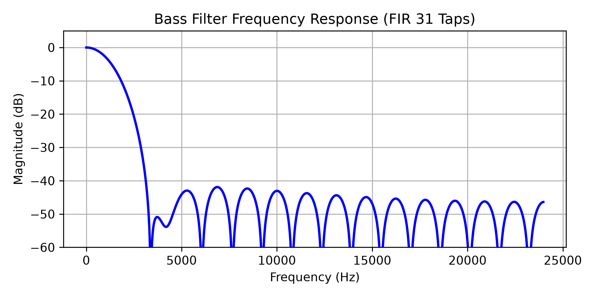
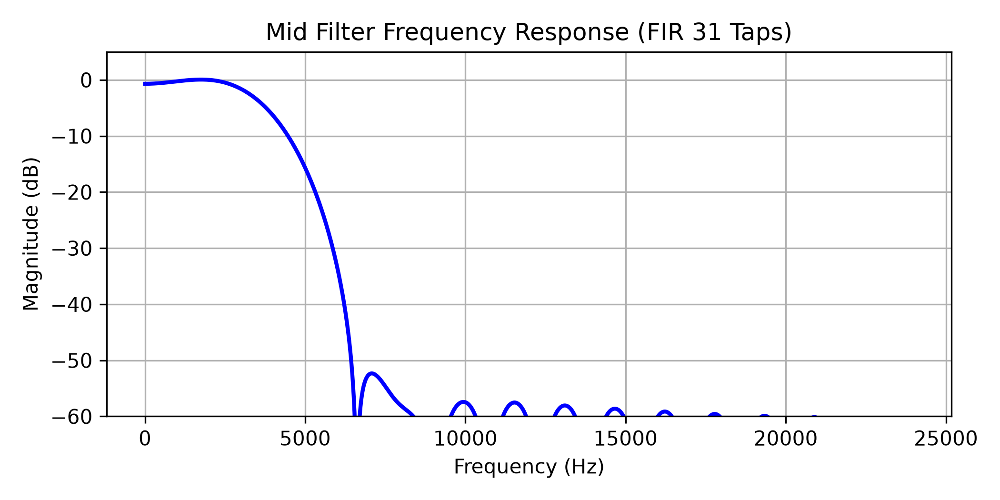
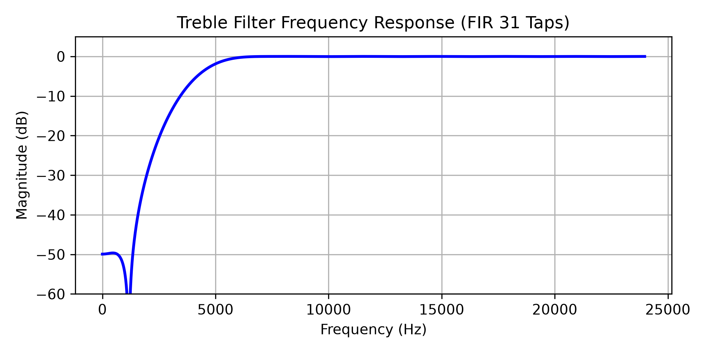
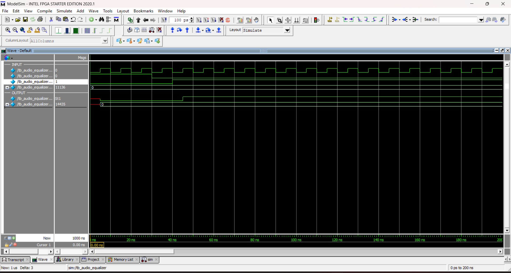
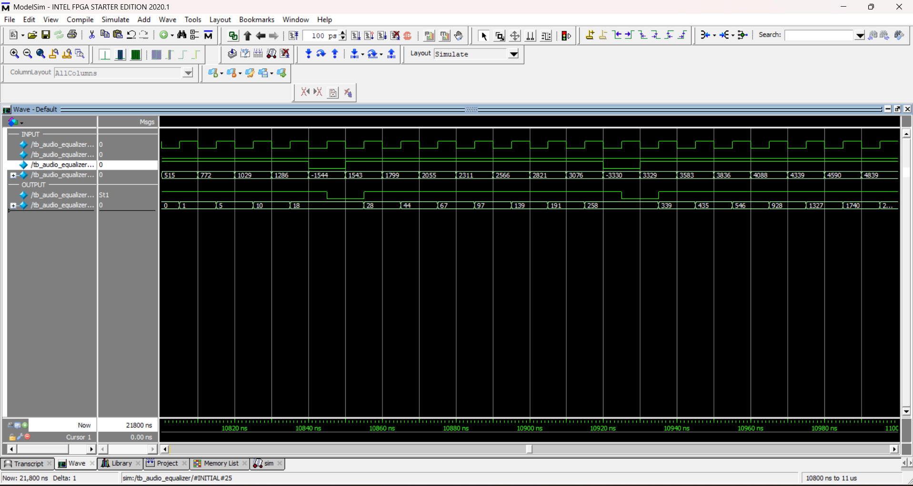

# Design and Verification of a 3-Band Digital Audio Equalizer Using Verilog HDL

Course: Digital Signal Processing (DGT302)


## Abstract

This project presents the design and verification
of a three-band digital audio equalizer using
Verilog HDL.

The system uses three parallel 31-tap FIR filters
to process Bass, Mid, and Treble frequency bands.
The filters are designed using a Hamming window
at a sampling rate of 48 kHz.

Each frequency band has an independent gain
control. The filtered signals are combined
through a mixer and limited to signed 16-bit
output values using saturation.

A Python Golden Model is developed to generate
reference output samples using fixed-point
arithmetic. A Verilog Testbench then compares
the RTL results against these reference values.

The saved ModelSim simulation shows 2021
comparisons with zero mismatches for the tested
unity-gain configuration.

The results demonstrate correct fixed-point
processing for the tested inputs. However,
the 31-tap filters have limited frequency
separation, particularly between the Bass
and Mid bands.


## Chapter 1. Introduction

### 1.1 Background

A digital audio equalizer adjusts the
frequency characteristics of an audio signal.

### 1.2 Project Objectives

- Design a 3-band digital audio equalizer.
- Implement DSP algorithms using Verilog HDL.
- Develop a Python Golden Model.
- Verify RTL using a Testbench.
- Compare RTL and Golden Model results.

### 1.3 Project Scope

Simulation-based design and verification.
No physical FPGA hardware is required.

## Chapter 2. Mathematical Background and Worked Example

### 2.1 FIR Filter Equation

The equalizer uses three 31-tap FIR filters for
Bass, Mid, and Treble frequency bands.

The FIR equation is:

$$
y[n] = \sum_{k=0}^{30} h[k]x[n-k]
$$

Here, x[n] is the input sample, h[k] is the
filter coefficient, and y[n] is the filtered output [1].

### 2.2 Hamming Window

A Hamming window is used when designing the
31-tap FIR coefficients.

$$
w[k] = 0.54 - 0.46\cos\left(\frac{2\pi k}{30}\right)
$$

The sampling rate is 48 kHz.

The three filters are designed with these cutoff
frequencies:

- Bass: Low-pass, 200 Hz
- Mid: Band-pass, 250-3800 Hz
- Treble: High-pass, 4000 Hz

### 2.3 Fixed-Point Arithmetic

The filter coefficients use signed Q1.15 format.

$$
h_Q[k] = \operatorname{sat}_{16}
\left(\operatorname{round}(h[k]\times 2^{15})\right)
$$

The FIR accumulator is calculated using integer
coefficients:

$$
A[n] = \sum_{k=0}^{30} x[n-k]h_Q[k]
$$

The RTL uses a signed 37-bit accumulator.

The output is obtained by arithmetic right shift
and 16-bit saturation:

$$
y_{\mathrm{FIR}}[n] =
\operatorname{sat}_{16}
\left(
\left\lfloor \frac{A[n]}{2^{15}} \right\rfloor
\right)
$$

Saturation limits the result to the signed
16-bit range of -32768 to 32767.

### 2.4 Gain Control and Mixer

Each band has an independent Q8.8 gain.

$$
y_g[n] =
\operatorname{sat}_{16}
\left(
\left\lfloor
\frac{y_{\mathrm{FIR}}[n]\times G_Q}{2^8}
\right\rfloor
\right)
$$

A gain value of 256 represents unity gain (1.0).

The three band outputs are added using an
18-bit signed mixer:

$$
M[n] = y_{b,g}[n] + y_{m,g}[n] + y_{t,g}[n]
$$

The final output is:

$$
y_{\mathrm{out}}[n] = \operatorname{sat}_{16}(M[n])
$$

### 2.5 Worked Calculation Example

This example uses actual data from the project.

At sample index 52:

- Current input x[52] = 515 (0x0203).
- Previous input x[51] = 257 (0x0101).

The earlier samples in the 31-tap history are
zero, so only two products contribute to each
FIR accumulator.

**Step 1: Bass FIR**

The first two Bass coefficients are 158 and 178.

$$
A_b = 515(158) + 257(178)
$$

$$
A_b = 81370 + 45746 = 127116
$$

After shifting by 15 bits:

$$
y_b = \left\lfloor \frac{127116}{32768} \right\rfloor = 3
$$

**Step 2: Mid FIR**

The first two Mid coefficients are 28 and 14.

$$
A_m = 515(28) + 257(14)
$$

$$
A_m = 14420 + 3598 = 18018
$$

$$
y_m = \left\lfloor \frac{18018}{32768} \right\rfloor = 0
$$

**Step 3: Treble FIR**

The first two Treble coefficients are -56 and -58.

$$
A_t = 515(-56) + 257(-58)
$$

$$
A_t = -28840 - 14906 = -43746
$$

$$
y_t = \left\lfloor \frac{-43746}{32768} \right\rfloor = -2
$$

For negative values, the arithmetic right shift
rounds toward negative infinity.

**Step 4: Gain Control**

The three gains are set to 256 (unity gain).

$$
y_{b,g} = \left\lfloor \frac{3 \times 256}{256} \right\rfloor = 3
$$

$$
y_{m,g} = \left\lfloor \frac{0 \times 256}{256} \right\rfloor = 0
$$

$$
y_{t,g} = \left\lfloor \frac{-2 \times 256}{256} \right\rfloor = -2
$$

**Step 5: Mixer and Final Saturation**

$$
M = 3 + 0 - 2 = 1
$$

Since the value is within the signed 16-bit
range, no saturation is needed.

$$
\boxed{y_{\mathrm{out}}[52] = 1 = \texttt{0x0001}}
$$

The calculated result matches sample index 52
in `data/expected_output.mem`.

This example follows the same fixed-point
operations used by the Python Golden Model
and the Verilog RTL.


## Chapter 3. Top-down System Design

### 3.1 System Overview

The project implements a three-band digital
audio equalizer using Verilog HDL.

The system processes signed 16-bit audio samples
through three parallel FIR filters:

- Bass: Low-pass filter
- Mid: Band-pass filter
- Treble: High-pass filter

Each filter output passes through a separate
gain control block.

The three signals are then combined by a mixer.
The final output is limited to the signed
16-bit range using saturation.

The design is verified through simulation.
No physical FPGA implementation is included.

### 3.2 System Architecture

The top-level module is `audio_equalizer_top`.

The input audio sample is sent to all three
FIR filters at the same time.

Each filter uses 31 taps and reads its
coefficients from a separate memory file.

The main processing path is:

Audio Input -> FIR Filters -> Gain Control
-> Mixer -> Output Saturation -> Audio Output

The Bass, Mid, and Treble filters operate
in parallel.

The gain blocks use signed Q8.8 values.
The mixer uses an 18-bit signed sum.
The final saturation block produces a
signed 16-bit output.

The system architecture diagram is stored
in the `docs/` directory.

### 3.3 Top-Level Interface

The top-level module receives:

- `clk`: System clock
- `rst`: Synchronous active-high reset
- `valid_in`: Input valid signal
- `sample_in`: Signed 16-bit audio sample
- `gain_bass_q8_8`: Bass gain
- `gain_mid_q8_8`: Mid gain
- `gain_treble_q8_8`: Treble gain

The outputs are:

- `sample_out`: Signed 16-bit audio sample
- `valid_out`: Output valid signal

The three FIR filters register their outputs
on the rising edge of the clock.

The top-level valid output is the AND of
the three filter valid signals.

Gain control, mixing, and final saturation
are combinational operations.

### 3.4 Design Parameters

| Parameter | Value |
|---|---|
| Sampling rate | 48 kHz |
| Audio input/output | Signed 16-bit |
| Frequency bands | 3 |
| FIR taps | 31 per filter |
| Window | Hamming |
| Coefficient format | Signed Q1.15 |
| Gain format | Signed Q8.8 |
| FIR accumulator | 37-bit signed |
| Mixer output | 18-bit signed |
| Final output | 16-bit signed |

The cutoff frequencies are:

- Bass: 200 Hz
- Mid: 250-3800 Hz
- Treble: 4000 Hz

The frequency responses depend on the
actual quantized filter coefficients.


## Chapter 4. DSP Design

### 4.1 FIR Filter Design

The project uses three FIR filters to process
different frequency ranges of an audio signal.

The filters are designed in Python using
`scipy.signal.firwin` with a Hamming window [2].

The sampling rate is 48 kHz, and each filter
contains 31 taps.

The coefficients are symmetric, giving the
filters a linear-phase response.

The same coefficients are used in the Python
Golden Model and the Verilog RTL.

### 4.2 Bass Low-Pass Filter

The Bass filter is designed as a low-pass FIR
filter with a nominal cutoff frequency of 200 Hz.

Its purpose is to keep low-frequency components
while reducing higher-frequency components.

The coefficients are stored in:

`dsp/coefficients/bass_coeff.mem`

Because the filter has only 31 taps, its
transition band is relatively wide.

### 4.3 Mid Band-Pass Filter

The Mid filter is designed as a band-pass FIR
filter with nominal cutoff frequencies of
250 Hz and 3800 Hz.

Its coefficients are stored in:

`dsp/coefficients/mid_coeff.mem`

The current filter does not strongly reject
very low frequencies. This limitation comes
from using a short 31-tap FIR at 48 kHz.

### 4.4 Treble High-Pass Filter

The Treble filter is designed as a high-pass
FIR filter with a nominal cutoff of 4000 Hz.

Its purpose is to preserve higher-frequency
components and reduce low-frequency components.

Its coefficients are stored in:

`dsp/coefficients/treble_coeff.mem`

### 4.5 Coefficient Generation

The coefficients are generated by:

`dsp/coeff_gen.py`

The script performs the following operations:

1. Set the sampling rate and filter parameters.
2. Generate the three FIR coefficient arrays.
3. Quantize each coefficient into Q1.15.
4. Save the coefficients in hexadecimal format.
5. Generate frequency response plots.

Each coefficient file contains 31 signed
16-bit hexadecimal values.

### 4.6 Fixed-Point Implementation

The Verilog FIR filters use signed 16-bit
samples and Q1.15 coefficients.

Each multiplication produces a signed
32-bit result.

The products are added using a signed
37-bit accumulator.

After accumulation, the result is shifted
right by 15 bits and saturated to 16 bits.

The detailed equations and calculation example
are presented in Chapter 2.

### 4.7 Frequency Response Analysis
The frequency responses are calculated using
`scipy.signal.freqz` in Python [3].







The generated frequency response plots are:

- `dsp/plots/bass_response.png`
- `dsp/plots/mid_response.png`
- `dsp/plots/treble_response.png`

The plots are generated from the floating-point
FIR coefficients before Q1.15 quantization.

An additional calculation using the stored
Q1.15 coefficients gives these approximate
responses:

| Frequency | Bass | Mid | Treble |
|---|---:|---:|---:|
| 0 Hz | 0.00 dB | -0.68 dB | -49.97 dB |
| 1 kHz | -2.81 dB | -0.24 dB | -55.19 dB |
| 4 kHz | -52.79 dB | -6.36 dB | -6.05 dB |

The results show that the three filters
operate differently across the frequency
range.

However, the Bass and Mid responses overlap
at low frequencies. The Mid filter also
provides little attenuation at DC.

This is a limitation of the selected
31-tap design and should be considered
when evaluating audio equalization quality.

The project focuses on the FIR implementation
and bit-exact verification in Verilog,
rather than high-performance audio filtering.


## Chapter 5. Golden Model

### 5.1 Purpose of the Golden Model

The Python Golden Model is used as a reference
for checking the Verilog implementation.

It performs the same fixed-point calculations
as the RTL, including FIR filtering, gain
control, mixing, and saturation.

The model is implemented in:

`dsp/golden_model.py`

Its main output is `expected_output.mem`.
The Verilog Testbench reads this file and
compares it with the actual RTL output.

The Golden Model does not simulate clock
cycles or hardware timing. It calculates
the expected value for each accepted sample.

### 5.2 Input Data and Coefficients

The model reads input samples from:

`data/input_samples.mem`

Each sample is stored as a 16-bit hexadecimal
number. The model converts the hexadecimal
values into signed integers.

For example:

- `0001` represents 1.
- `FFFF` represents -1.
- `8000` represents -32768.
- `7FFF` represents 32767.

The model also loads three coefficient files:

- `dsp/coefficients/bass_coeff.mem`
- `dsp/coefficients/mid_coeff.mem`
- `dsp/coefficients/treble_coeff.mem`

Each file contains 31 signed Q1.15
coefficients.

Using the same coefficient files ensures
that the Python model and RTL use identical
quantized filter parameters.

### 5.3 Golden Model Processing

The model uses a 31-element sample history,
initially filled with zeros.

For every input sample, the following
operations are performed.

**Step 1: Update sample history**

The newest sample is inserted at the
beginning of the history array.

The oldest sample is removed.

In Python:

```python
shift_reg = [x] + shift_reg[:-1]
```

**Step 2: FIR calculations**

The model calculates a separate
multiply-accumulate result for each band.

For example, the Bass accumulator is:

```python
acc_b = sum(
    shift_reg[i] * hb[i]
    for i in range(num_taps)
)
```

The Mid and Treble accumulators use their
own coefficient arrays.

All three filters use the same input history.

**Step 3: Fixed-point scaling**

Each FIR accumulator is shifted right
by 15 bits and saturated to signed 16-bit.

For example:

```python
yb = saturate16(acc_b >> 15)
```

Python's right shift on negative integers
matches the arithmetic right-shift behavior
required by the signed RTL calculation.

**Step 4: Gain control**

The model converts gain values into
signed Q8.8 integers.

For unity gain:

```python
gb_int = 256
gm_int = 256
gt_int = 256
```

The gain operation multiplies the FIR
result by the gain integer, shifts the
product right by 8 bits, and applies
16-bit saturation.

For example:

```python
yb_g = saturate16((yb * gb_int) >> 8)
```

The same operation is used for the
Mid and Treble bands.

**Step 5: Mixing**

The three gain-adjusted outputs are added:

```python
mixed_18bit = yb_g + ym_g + yt_g
```

The result is limited to the signed
16-bit range:

```python
final_out = saturate16(mixed_18bit)
```

**Step 6: Store output**

The final integer is converted to a
16-bit hexadecimal value and added
to the output list.

The process repeats for every input sample.

### 5.4 Reference Output Generation

The current input file contains 1010 samples.

The Golden Model generates one expected
output for each input sample.

The generated values are written to:

`data/expected_output.mem`

The default configuration uses unity gain
for all three bands:

- Bass gain = 1.0
- Mid gain = 1.0
- Treble gain = 1.0

In Q8.8 format, each gain is represented
by the integer value 256.

The example in Chapter 2 uses sample index
52 from these files.

The calculated result is:

- Bass output: 3
- Mid output: 0
- Treble output: -2
- Final output: 1 (`0001` in hexadecimal)

This matches the stored reference output.

### 5.5 Comparison with RTL

The Golden Model provides expected output
values before Verilog simulation.

The Testbench reads the input and expected
output files and drives the RTL design.

After each valid input sample, the
Testbench checks `valid_out` and compares
the RTL output against the reference value.

A mismatch is recorded when the output
is invalid or differs from the expected
16-bit value.

The saved ModelSim results show:

| Test | Comparisons | Mismatches |
|---|---:|---:|
| Continuous input | 1010 | 0 |
| Input with valid gaps | 1010 | 0 |
| Reset recovery | 1 | 0 |
| Total | 2021 | 0 |

All comparisons passed with unity gains.

The Python model does not explicitly
handle reset signals or idle clock cycles.
These timing behaviors are tested by the
Verilog Testbench.

The current results confirm matching
fixed-point outputs for the tested data
and configuration. They do not establish
correct behavior for every possible
gain setting or input combination.


## Chapter 6. RTL Implementation

### 6.1 RTL Module Structure

The audio equalizer is implemented using eight
Verilog modules.

| Module | Function |
|---|---|
| audio_equalizer_top | Connects the complete system |
| fir_filter | Performs FIR filtering |
| bass_filter | Bass filter wrapper |
| mid_filter | Mid filter wrapper |
| treble_filter | Treble filter wrapper |
| gain_control | Applies Q8.8 gain |
| mixer | Adds the three band outputs |
| saturation | Limits the final output to 16 bits |

The three filter wrappers use the same
`fir_filter` module with different coefficient
files.

This allows the FIR implementation to be reused
for all three frequency bands.

### 6.2 FIR Filter Implementation

The main FIR module is located in
`rtl/fir_filter.v`.

Each filter contains 31 taps and processes
signed 16-bit input samples.

The coefficients are stored in a memory array
and loaded using `$readmemh`.

The FIR datapath contains:

- A delay line storing 30 previous valid samples.
- 31 signed multiplications.
- A signed 37-bit accumulator.
- An arithmetic right shift by 15 bits.
- A 16-bit saturation function.
- Output and valid registers.

Each multiplication produces a signed 32-bit
result. The products are sign-extended before
being added to the accumulator.

The arithmetic calculation is combinational.
The filtered result is stored in `sample_out`
on a rising clock edge when `valid_in` is high.

When `valid_in` is low, the delay line and
registered sample output keep their values.

When `rst` is high, the delay line, sample
output register, and valid flag are cleared
on the next rising clock edge.

### 6.3 Gain Control

The gain module is implemented in
`rtl/gain_control.v`.

Each frequency band has a separate instance
of the same gain control module.

The module accepts:

- A signed 16-bit filtered sample.
- A signed 16-bit Q8.8 gain value.

The multiplication produces a signed 32-bit
result. It is shifted right by 8 bits and
saturated to signed 16-bit.

A gain value of 256 represents 1.0.

Gain control is combinational and does not
introduce an additional registered stage.

### 6.4 Mixer and Output Saturation

The mixer is implemented in `rtl/mixer.v`.

It receives the three signed 16-bit
gain-adjusted outputs.

Each input is sign-extended to 18 bits
before addition.

The mixer produces a signed 18-bit result,
which is passed to `rtl/saturation.v`.

The saturation module limits the output to:

- Maximum: 32767
- Minimum: -32768

If the mixed value exceeds these limits,
the output is clipped to the corresponding
boundary.

Otherwise, the signed value is preserved.

### 6.5 Top-Level Integration

The top-level module is
`rtl/audio_equalizer_top.v`.

It instantiates three FIR filter wrappers,
three gain control blocks, one mixer,
and one output saturation block.

The same `sample_in` signal is connected
to all three FIR filters.

Each filter uses a separate coefficient file:

- Bass: `bass_coeff.mem`
- Mid: `mid_coeff.mem`
- Treble: `treble_coeff.mem`

The three FIR valid signals are combined
using an AND operation:

`valid_out = valid_bass & valid_mid & valid_treble`

Because the FIR filters share the same
clock, reset, and input valid signal,
their registered valid outputs are aligned.

The gain, mixer, and final saturation stages
are combinational.

A valid output sample is available after
the rising edge that accepts a valid input,
once the registered and combinational signals
have settled.

The system uses a synchronous active-high
reset and does not require physical FPGA
hardware for the current project.

### 6.6 RTL Simulation

The integrated RTL was simulated using
ModelSim Intel FPGA Edition 2020.1.

The Testbench supplies input audio samples
and checks the corresponding output values
against the Python Golden Model.

The saved simulation log reports:

- Continuous input: 1010 samples, 0 errors.
- Input with valid gaps: 1010 samples, 0 errors.
- Reset recovery: 1 comparison, 0 errors.
- Total: 2021 comparisons, 0 errors.

The overall simulation result is PASS.

These results apply to the tested
unity-gain configuration.

The detailed verification process and
simulation evidence are presented in
Chapter 7.


## Chapter 7. Verification

### 7.1 Testbench Architecture

The Verilog Testbench is implemented in
`tb/tb_audio_equalizer.v`.

Its purpose is to verify the RTL output
against the Python Golden Model.

The Testbench includes:

- Clock and reset generation.
- Input sample reading.
- Expected output reading.
- DUT input control.
- Output comparison.
- Error counting and result logging.

The Testbench instantiates the top-level
module `audio_equalizer_top`.

Input samples are read from:

`data/input_samples.mem`

Expected outputs are read from:

`data/expected_output.mem`

The expected values are generated by the
Python Golden Model before RTL simulation.

All three gain inputs are set to 256,
representing unity gain in Q8.8 format.

### 7.2 Verification Test Plan

The current Testbench uses three main
verification scenarios.

**Test 0: Continuous Input**

The Testbench sends 1010 consecutive
valid input samples to the DUT.

Each output is compared with the
corresponding Golden Model value.

This test checks the FIR calculations,
gain processing, mixing, and saturation
for the supplied input data.

**Test 1: Input with Valid Gaps**

The Testbench uses the same 1010 samples
but inserts invalid clock cycles before
selected input samples.

An invalid cycle is inserted before
every seventh sample index, starting
at index 0.

During these cycles, `valid_in` is low.

The Testbench checks that `valid_out`
is also low.

The output values for subsequent valid
samples are compared with the same
Golden Model reference.

This checks that invalid cycles do not
advance the FIR sample history.

**Test 2: Reset Recovery**

After the two input tests, the Testbench
asserts the synchronous reset while
`valid_in` is high.

It checks that `valid_out` is low and
the registered output is cleared.

The Testbench then releases reset,
sends the first input sample again,
and compares the resulting output
with its expected value.

### 7.3 RTL and Golden Model Comparison

The Testbench drives input signals
on falling clock edges.

The DUT processes valid input samples
on rising clock edges.

The Testbench checks the results
1 ns after each rising edge, allowing
the registered outputs and combinational
logic to settle.

The simulation clock period is 10 ns.

This is the Testbench clock period,
not the 48 kHz audio sampling frequency
used during FIR coefficient design.

A comparison passes when:

- `valid_out` is high for an accepted sample.
- `sample_out` matches the expected
  signed 16-bit reference word.

The Testbench uses exact 16-bit
comparisons rather than an error tolerance.

During invalid cycles, it checks that
`valid_out` is low.

The comparison results are saved in:

- `simulation/results/results.csv`
- `simulation/results/test_results.txt`

The CSV file contains the results for
the 2020 valid samples in Tests 0 and 1.
The additional reset-recovery comparison
is included in the summary log.

### 7.4 Waveform Analysis





The project includes saved ModelSim
waveform screenshots:

- `docs/images/waveform_continuous.png`
- `docs/images/waveform_valid_gaps.png`

The continuous-input waveform is used
to observe the normal sample flow.

The valid-gap waveform shows the behavior
when input samples are separated by
invalid clock cycles.

The relevant signals include:

- `clk`
- `rst`
- `valid_in`
- `sample_in`
- `valid_out`
- `sample_out`

The FIR output registers update when
a valid sample is accepted.

During invalid cycles, the FIR history
and registered filtered samples are held,
while the output valid signal is low.

The gain, mixer, and final saturation
blocks are combinational.

Therefore, the final output should only
be treated as valid when `valid_out = 1`.

### 7.5 Verification Results

The saved RTL simulation was performed
using ModelSim Intel FPGA Edition 2020.1.

The recorded results are:

| Test | Comparisons | Errors | Result |
|---|---:|---:|---|
| Continuous input | 1010 | 0 | PASS |
| Input with valid gaps | 1010 | 0 | PASS |
| Reset recovery | 1 | 0 | PASS |
| Total | 2021 | 0 | PASS |

The simulation console reports:

```text
TEST 0: samples=1010 errors=0
TEST 1: samples=1010 errors=0
SUMMARY compared=2021 errors=0
OVERALL PASS
```

The recorded simulation completed
without reported errors or warnings.

All 2021 compared output samples
matched the Golden Model reference
for the tested configuration.

### 7.6 Verification Limitations

The current Testbench uses unity gain
for all three frequency bands.

It does not separately verify:

- Different Bass, Mid, and Treble gains.
- Mute operation using zero gain.
- Negative gain values.
- Fractional or high gain values.
- Every possible input combination.

The supplied samples do exercise
final output saturation, but they do
not cover every saturation condition.

The saved PASS result therefore confirms
correct operation for the tested data,
gain settings, and timing scenarios.

Additional gain and boundary-value tests
would improve verification coverage.


## Chapter 8. Results and Discussion

### 8.1 FIR Filter Results

The project generated three FIR filters using
the Hamming window method.

Each filter contains 31 coefficients stored
in signed Q1.15 format.

The frequency response plots are saved in:

- `dsp/plots/bass_response.png`
- `dsp/plots/mid_response.png`
- `dsp/plots/treble_response.png`

The Bass filter mainly responds to lower
frequencies, while the Treble filter responds
to higher frequencies.

The Mid filter was designed for the frequency
range from 250 Hz to 3800 Hz.

However, the calculated response from the stored
Q1.15 coefficients shows that the Mid filter
does not strongly reject very low frequencies.

At DC, its magnitude is approximately -0.68 dB.

This happens because 31 taps are not enough
to produce a narrow transition band at
these low cutoff frequencies.

The filter design is suitable for studying
FIR implementation, but its frequency
separation is limited.

### 8.2 Golden Model Results

The Python Golden Model processed 1010
input samples using the three FIR filters,
Q8.8 gains, mixing, and saturation.

All three gains were set to unity (256).

The model generated 1010 expected samples
in `data/expected_output.mem`.

An independent integer calculation using
the stored coefficients matched all 1010
expected samples.

The worked example in Chapter 2 also matched
the stored output at sample index 52.

### 8.3 RTL Verification Results

The integrated Verilog design was simulated
using ModelSim Intel FPGA Edition 2020.1.

The saved results are:

| Test | Comparisons | Errors | Result |
|---|---:|---:|---|
| Continuous input | 1010 | 0 | PASS |
| Valid gaps | 1010 | 0 | PASS |
| Reset recovery | 1 | 0 | PASS |
| Total | 2021 | 0 | PASS |

No mismatches were reported.

The results show that the RTL and Python
Golden Model produce the same fixed-point
outputs for the tested samples.

The valid-gap test also checks that the
FIR history advances only when a valid
sample is accepted.

The reset-recovery test confirms that the
stored filter history is cleared by reset.

### 8.4 Saturation Behavior

The equalizer uses saturation after FIR
filtering, gain control, and final mixing.

The final mixer combines the three
gain-adjusted band outputs.

If the result exceeds the signed 16-bit
range, it is limited to 32767 or -32768.

The current input data includes values
that cause final output saturation.

For example, at sample index 146, an
independent integer calculation gives
a mixer sum of 32911.

The final output is therefore:

32767 (0x7FFF)

This agrees with the stored Golden Model
reference value.

Saturation prevents output wraparound,
although clipping can still introduce
distortion in a real audio application.

### 8.5 Project Limitations

The project has several limitations.

First, the three 31-tap FIR filters do not
provide sharp frequency separation.
The Bass and Mid responses overlap at
lower frequencies.

Second, the current Testbench mainly checks
unity-gain operation. Other gain settings,
such as mute, fractional gain, and negative
gain, have not been separately verified.

Third, the design has only been tested
through RTL simulation. It has not been
implemented on physical FPGA hardware.

The project also does not include a real
audio input/output interface.

### 8.6 Discussion

The main goal of this project is to design
and verify a three-band digital audio
equalizer using Verilog HDL.

The RTL implementation and Python reference
model use the same fixed-point arithmetic
rules and filter coefficients.

The saved simulation shows successful
output matching for the tested configuration.

The results demonstrate the implementation
of FIR filtering, gain control, mixing,
saturation, and sample-valid handling.

Better frequency separation and broader
verification coverage would be useful
improvements in future versions.


## Chapter 9. Conclusion

This project designed and verified a three-band
digital audio equalizer using Verilog HDL.

The system consists of three 31-tap FIR filters
for Bass, Mid, and Treble frequency bands.
Each band has an independent Q8.8 gain control.
The filtered signals are combined using a mixer
and limited to signed 16-bit output values.

A Python Golden Model was developed to generate
reference outputs using the same fixed-point
arithmetic as the RTL.

The Verilog design was tested using ModelSim.
The saved simulation results show 2021 output
comparisons with zero mismatches for the
tested unity-gain configuration.

The project demonstrates FIR filtering,
fixed-point arithmetic, gain control, mixing,
saturation, and RTL verification.

However, the 31-tap filters have limited
frequency separation, especially between
the Bass and Mid bands. The Testbench also
does not cover all possible gain settings.

Future improvements could include longer
FIR filters, additional gain test cases,
and implementation on an FPGA board.

Overall, the project achieved its main
simulation and verification objectives
for the tested configuration.


## References

[1] A. V. Oppenheim and R. W. Schafer,
*Discrete-Time Signal Processing*,
3rd Edition, Pearson, 2010.

[2] SciPy Documentation,
"scipy.signal.firwin - FIR filter design
using the window method."
https://docs.scipy.org/doc/scipy/reference/generated/scipy.signal.firwin.html

[3] SciPy Documentation,
"scipy.signal.freqz - Compute the frequency
response of a digital filter."
https://docs.scipy.org/doc/scipy/reference/generated/scipy.signal.freqz.html
